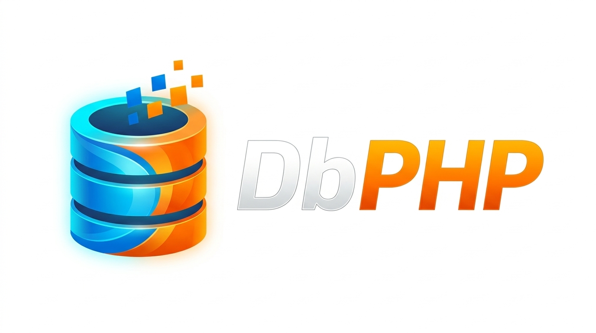

<div id="top" align="center">
<h1>
  

  <a href="https://navto.me/heliomarpm" target="_blank"></a>
  [](https://github.com/heliomarpm/db-php/actions)
  [![CodeFactor][url-codefactor-badge]][url-codefactor]
  [![Packagist Version][url-packagist-badge]][url-packagist]
  [![Packagist Downloads][url-packagist-downloads-badge]][url-packagist]
</h1>

<div class="badges">

  [![GitHub Sponsors][url-github-sponsors-badge]][url-github-sponsors]
  [![PayPal][url-paypal-badge]][url-paypal]
  [![Ko-fi][url-kofi-badge]][url-kofi]
  [![Liberapay][url-liberapay-badge]][url-liberapay]

</div>
</div>

**DbPHP** é uma biblioteca leve, moderna e de alta performance para conexão e manipulação de bancos de dados relacionais em PHP 8.2+.

Oferece suporte unificado a **PDO** e **MySQLi**, paginação nativa, prepared statements com parâmetros nomeados (`:param`) e posicionais (`?`), telemetria nativa de execução, transações atômicas seguras e integração fluida com coleções em memória via [linq-php](https://github.com/heliomarpm/linq-php).

> 🚀 **[Experimente o Laboratório Interativo Online](https://db-php.vercel.app/)**  
> Teste cenários reais de consultas, telemetria, transações e SQL livre direto no navegador!

---

## ⚡ Destaques

- **Zero Dependências**: Construído exclusivamente sobre os módulos nativos do PHP (`ext-pdo` e `ext-mysqli`).
- **Parâmetros Nomeados Universais**: Use `:param` tanto com PDO quanto com MySQLi (tradução transparente).
- **Telemetria Integrada**: Obtenha o tempo exato de execução da query (`$result->elapsedTime`) e contagem (`$result->count`) sem overhead.
- **DTO Imutável `QueryResult`**: Métodos ergonômicos como `$result->column('nome')`, `$result->row`, `$result->rows` e `firstOrDefault()`.
- **Transações Atômicas**: Gerenciamento de bloco `DB::transaction()` com auto-commit e auto-rollback.
- **Ponte com LinqPHP**: Encadeie pipelines de transformação em memória chamando `->linq()` a partir do resultado da query.

---

## 📦 Requisitos

- PHP 8.2 ou superior
- Extensões `pdo` (com drivers como `pdo_mysql`, `pdo_sqlite`) e/ou `mysqli`

## 📥 Instalação

```bash
composer require heliomarpm/db-php
```

---

## 🚀 Guia Prático de Uso

### 1. Inicialização e Conexão

```php
use HeliomarPM\DbPHP\DB;

// SQLite em memória (ideal para testes, microserviços e serverless):
$db = DB::sqlite();

// SQLite em arquivo persistente:
$db = DB::sqlite("/caminho/para/database.sqlite");

// MySQL via Driver PDO:
$db = DB::mysql(
    database: "minha_base",
    username: "usuario",
    password: "senha_segura",
    host: "127.0.0.1",
    port: 3306
);

// MySQL nativo via Driver MySQLi (aceita 'host' ou 'hostname'):
$db = DB::connect([
    "driver"   => "mysqli",
    "host"     => "127.0.0.1",
    "database" => "minha_base",
    "username" => "usuario",
    "password" => "senha_segura",
    "charset"  => "utf8mb4"
]);

// Multi-conexão e alternância de conexão padrão:
DB::connect(Config::forSqlite(":memory:"), name: "cache");
DB::setDefaultConnection("cache"); // Direciona DB::query() para a conexão 'cache'
```

---

### 2. Consultas (`SELECT`) e Parâmetros Seguros

#### 2.1 Parâmetros Nomeados (`:param`) — Recomendado para legibilidade
Você pode usar parâmetros nomeados passando um array associativo com ou sem o prefixo `:`:

```php
// Busca produtos com preço e estoque mínimos definidos por chave nomeada:
$result = DB::query("
    SELECT id_produto, nome_produto, preco, estoque
    FROM produtos
    WHERE preco >= :min_preco AND estoque >= :min_estoque
    ORDER BY preco DESC
", [
    "min_preco"   => 89.90,
    "min_estoque" => 10,
]);

// O DbPHP aceita tanto ['min_preco' => 89.90] quanto [':min_preco' => 89.90]
```

#### 2.2 Parâmetros Posicionais (`?`)
Também é possível usar placeholders posicionais com array indexado:

```php
$result = DB::query("
    SELECT * FROM clientes
    WHERE uf = ? AND vip = ?
", ["SP", 1]);
```

---

### 3. Trabalhando com os Resultados (`QueryResult`)

O objeto retornado por `DB::query()` disponibiliza propriedades e métodos ergonômicos:

```php
$result = DB::query("SELECT id_produto, nome_produto, preco FROM produtos");

// 📊 Métricas de Telemetria:
echo $result->count;       // Quantidade de registros retornados (int)
echo $result->elapsedTime; // Tempo de execução em segundos (ex: 0.000185s)

// 📋 Leitura dos Registros:
print_r($result->row);     // Primeira linha como array associativo (ou [] se vazio)
print_r($result->rows);    // Todas as linhas (array de arrays)

// 🎯 Extração Direta de Coluna (elimina array_column):
$nomes = $result->column("nome_produto");
// Retorna: ["PLA Preto", "PETG Branco", "Bico Extrusor", ...]

// 🔍 Localização com Condição (Early-Exit):
$produtoBarato = $result->firstOrDefault(fn($p) => (float)$p["preco"] < 50.00);

// 🔁 Iteração Direta (QueryResult implementa IteratorAggregate):
foreach ($result as $linha) {
    echo "{$linha['nome_produto']} - R$ {$linha['preco']}\n";
}
```

---

### 4. Operações de Escrita (`INSERT`, `UPDATE`, `DELETE`)

Utilize `DB::execute()` para operações que modificam dados. Ele retorna o **número de linhas afetadas**:

#### 4.1 Inserção e Obtenção do ID Gerado
```php
$afetados = DB::execute("
    INSERT INTO clientes (nome_cliente, uf, cidade, vip, saldo_credito)
    VALUES (:nome, :uf, :cidade, :vip, :saldo)
", [
    "nome"   => "Mariana Silva",
    "uf"     => "MG",
    "cidade" => "Belo Horizonte",
    "vip"    => 1,
    "saldo"  => 250.00
]);

$novoId = DB::lastInsertId(); // ID autonumérico inserido (ex: 9)
```

#### 4.2 Atualização com Parâmetros Nomeados
```php
$reajustados = DB::execute("
    UPDATE produtos
    SET preco = preco * :fator
    WHERE id_categoria = :categoria AND estoque > :min_estoque
", [
    "fator"       => 1.10, // Reajuste de 10%
    "categoria"   => 1,
    "min_estoque" => 0,
]);

echo "Total de produtos atualizados: {$reajustados}";
```

#### 4.3 Exclusão Controlada
```php
$removidos = DB::execute("
    DELETE FROM pedidos
    WHERE status = :status AND data_pedido < :limite
", [
    "status" => "cancelado",
    "limite" => "2026-01-01 00:00:00",
]);
```

---

### 5. Transações Atômicas Seguras (`DB::transaction`)

O método `DB::transaction()` encapsula a execução em um bloco com auto-commit e auto-rollback. Se qualquer exceção for lançada dentro da closure, a transação é revertida imediatamente:

```php
// Exemplo: Transferência bancária atômica que retorna o protocolo da operação
$protocolo = DB::transaction(function ($driver) {
    // 1. Debita da conta de origem:
    $driver->execute("
        UPDATE contas
        SET saldo = saldo - :valor
        WHERE id_conta = :origem AND saldo >= :valor
    ", [
        "valor"  => 500.00,
        "origem" => 1,
    ]);

    // 2. Credita na conta de destino:
    $driver->execute("
        UPDATE contas
        SET saldo = saldo + :valor
        WHERE id_conta = :destino
    ", [
        "valor"   => 500.00,
        "destino" => 2,
    ]);

    // 3. Registra comprovante:
    $driver->execute("
        INSERT INTO transferencias (conta_origem, conta_destino, valor, data_hora)
        VALUES (:origem, :destino, :valor, datetime('now'))
    ", [
        "origem"  => 1,
        "destino" => 2,
        "valor"   => 500.00,
    ]);

    return $driver->lastInsertId();
});

echo "Transferência confirmada com ID: {$protocolo}";
```

---

### 6. Poder Combinado: `DbPHP` + `LinqPHP`

Se você tiver a biblioteca parceira [`heliomarpm/linq-php`](https://github.com/heliomarpm/linq-php) instalada, você pode encadear métodos LINQ diretamente do resultado da consulta SQL:

```php
$destaques = DB::query("
    SELECT p.id_produto, p.nome_produto, c.nome_categoria, p.preco, p.estoque
    FROM produtos p
    INNER JOIN categorias c ON c.id_categoria = p.id_categoria
")
->linq()
->where(fn($p) => (float)$p["preco"] > 50.00)
->orderByKey("preco", descending: true)
->select([
    "id_produto"     => "Código",
    "nome_produto"   => "Produto",
    "nome_categoria" => "Categoria",
    "preco"          => "Preço",
])
->take(5)
->toArray();
```

---

### 7. Paginação Nativa com `DB::paginate()`

O método `DB::paginate()` calcula automaticamente o `COUNT(*)` total da consulta, injeta de forma segura as cláusulas `LIMIT` e `OFFSET` e retorna um DTO imutável e estruturado (`PaginatedResult`):

```php
$paginado = DB::paginate(
    sql: "SELECT * FROM produtos WHERE preco >= :preco ORDER BY id_produto DESC",
    params: ["preco" => 50.00],
    page: 1,
    perPage: 15
);

// 📋 Dados da Página Atual:
$itens = $paginado->items; // Array de linhas da página (ou iteração via foreach)

// 📊 Metadados de Paginação:
echo $paginado->total;            // Total geral de registros encontrados (ex: 45)
echo $paginado->currentPage;      // Página atual: 1
echo $paginado->lastPage;         // Total de páginas calculadas: 3
echo $paginado->perPage;          // Itens por página: 15
echo $paginado->from;             // Índice inicial: 1
echo $paginado->to;               // Índice final: 15
echo $paginado->hasMorePages;     // true se houver próxima página
echo $paginado->hasPreviousPages; // true se houver página anterior
echo $paginado->elapsedTime;      // Tempo total somado (contagem + consulta)

// ⚡ Serialização JSON direta para APIs REST:
header('Content-Type: application/json');
echo json_encode($paginado);
```

#### Resposta JSON gerada automaticamente:
```json
{
  "data": [
    { "id_produto": 110, "nome_produto": "Impressora 3D", "preco": 3450.00 }
  ],
  "pagination": {
    "total": 45,
    "per_page": 15,
    "current_page": 1,
    "last_page": 3,
    "from": 1,
    "to": 15,
    "has_more": true,
    "has_previous": false
  },
  "elapsed_time": 0.000325
}
```

---

## 🖥️ Laboratório Interativo Local

Você pode iniciar o servidor de demonstração interativo com todas as tabelas e cenários pré-configurados com um único comando:

```bash
composer start
```

Em seguida, abra **[http://localhost:8000](http://localhost:8000)** no navegador para explorar as métricas de telemetria, testar transações e rodar consultas SQL em tempo real.

---

## 🧪 Qualidade de Código e Testes

O projeto segue rigorosos padrões de tipagem estrita e cobertura de testes:

```bash
# Rodar todos os testes unitários (PHPUnit 100% verde)
composer test

# Análise estática de tipos (PHPStan no Nível 8 mais rigoroso)
composer lint

# Validação e formatação de código (Laravel Pint)
composer format
composer format:fix
composer format:full

# Verificação completa da suíte
composer check
```

---

## 🤝 Contribuições e suporte

Existem várias formas de contribuir:

- ⭐ Marcar o repositório com uma estrela
- 🐞 Relatar bugs
- 💡 Sugerir funcionalidades ou novos drivers
- 🧾 Melhorar a documentação
- 📢 Compartilhar o projeto

Para propor uma melhoria ou contribuição, veja o [Guia de Contribuição](https://github.com/heliomarpm/db-php/blob/main/docs/CONTRIBUTING.md).\
Se precisar de ajuda ou encontrou um problema, consulte o [Suporte](https://github.com/heliomarpm/db-php/blob/main/docs/SUPPORT.md) ou abra uma [Issue](https://github.com/heliomarpm/db-php/issues). Leia também o [Código de Conduta](https://github.com/heliomarpm/db-php/blob/main/docs/CODE_OF_CONDUCT.md).

Obrigado a todos que já contribuíram:

[](https://github.com/heliomarpm/db-php/graphs/contributors)

###### Criado com [contrib.nn](https://contrib.nn.ci/?repo=heliomarpm/db-php&no_bot=true)

## 💵 Apoie o Projeto

Se você gosta do projeto, considere fazer uma doação ao desenvolvedor via GitHub Sponsors, Ko-fi, PayPal ou Liberapay — a escolha é sua. 😉

[![GitHub Sponsors][url-github-sponsors-badge]][url-github-sponsors]
[![PayPal][url-paypal-badge]][url-paypal]
[![Ko-fi][url-kofi-badge]][url-kofi]
[![Liberapay][url-liberapay-badge]][url-liberapay]

## 📝 Licença

Distribuído sob a licença [MIT](https://github.com/heliomarpm/db-php/blob/main/LICENSE) © [Heliomar P. Marques](https://github.com/heliomarpm).\
Sinta-se livre para utilizar, customizar e estender estas bibliotecas nos seus ambientes de desenvolvimento. [🔝](#top)

---
<!-- Sponsor badges -->
[url-github-sponsors]: https://github.com/sponsors/heliomarpm
[url-github-sponsors-badge]: https://img.shields.io/badge/GitHub%20-Sponsor-1C1E26?style=for-the-badge&labelColor=1C1E26&color=db61a2
[url-kofi]: https://ko-fi.com/heliomarpm
[url-kofi-badge]: https://img.shields.io/badge/kofi-1C1E26?style=for-the-badge&labelColor=1C1E26&color=ff5f5f
[url-liberapay]: https://liberapay.com/heliomarpm
[url-liberapay-badge]: https://img.shields.io/badge/liberapay-1C1E26?style=for-the-badge&labelColor=1C1E26&color=f6c915
[url-paypal]: https://bit.ly/paypal-sponsor-heliomarpm
[url-paypal-badge]: https://img.shields.io/badge/donate%20on-paypal-1C1E26?style=for-the-badge&labelColor=1C1E26&color=0475fe

<!-- Packagist badges -->
[url-packagist]: https://packagist.org/packages/heliomarpm/db-php
[url-packagist-badge]: https://img.shields.io/packagist/v/heliomarpm/db-php
[url-packagist-downloads-badge]: https://img.shields.io/packagist/dt/heliomarpm/db-php

<!-- other badges -->
[url-codefactor]: https://www.codefactor.io/repository/github/heliomarpm/db-php
[url-codefactor-badge]: https://www.codefactor.io/repository/github/heliomarpm/db-php/badge